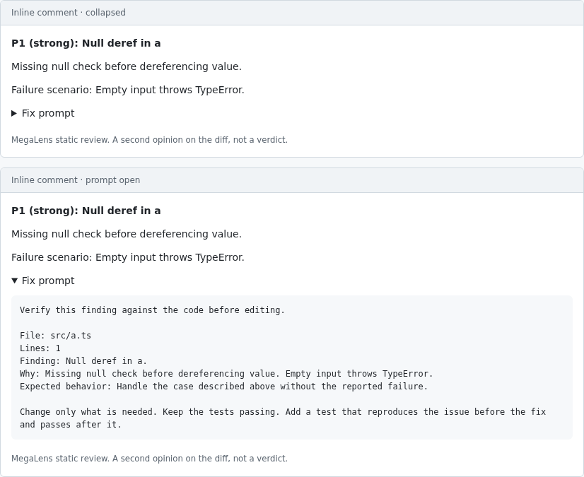

# Copy fix prompt and PR walkthrough

## What changed

* Every displayed inline or summary finding has a collapsed **Fix prompt**. The plain text fence contains the file and line range when available, the issue and its impact, the expected behavior, and instructions to keep the change small, keep tests passing, and add a regression test. The formatter redacts known credentials and leaves out the evidence quote and diff text.
* Complete and partial reviews update one walkthrough per PR across tiers. The first 15 files show their change type and line counts when GitHub provides them. **Look at first** uses up to three strong findings or files with the most changed lines. The existing tier summaries still hold review status and detailed findings. A failed review or a `too_large` refusal updates the tier summary and leaves the last walkthrough identified by its commit.
* Publishing reuses the engine result and the GitHub file list already used for inline placement. There are no new model calls or credits. Walkthrough updates use the same author check and live head check as tier summary updates. Both example workflows already use the same per PR concurrency group.

## Dry run

`node scripts/render-dry-run.mjs` loaded the saved `complete-with-route.json` engine result and captured the publish payloads with mocked GitHub calls. It rendered the same finding inline with a matching hunk and in the collapsed findings summary when the hunk was unavailable. `npm test` passed all 160 tests, including updates across pushes and tiers, stale head handling, and formatter limits.

The screenshots are local browser renders. The dry run verified expansion and the plain text code block. GitHub’s own copy control requires a live PR to verify. [GitHub documentation on collapsed sections](https://docs.github.com/en/get-started/writing-on-github/working-with-advanced-formatting/organizing-information-with-collapsed-sections)

### Inline review comment

[Inline comment Markdown](dry-run/inline-comment.md)

### Findings summary

[Findings summary Markdown](dry-run/findings-summary.md)

### PR walkthrough

[PR walkthrough Markdown](dry-run/pr-walkthrough.md)

## Open questions

* Should a failed or refused run refresh the walkthrough from the diff file list alone?
* Should a future engine version provide a dedicated expected behavior field and file descriptions? The pinned schema has neither, so prompts use the reported failure and the walkthrough uses GitHub file metadata.

Git staging was blocked because `.git` is mounted read only in this workspace. The changes remain in the working tree.
